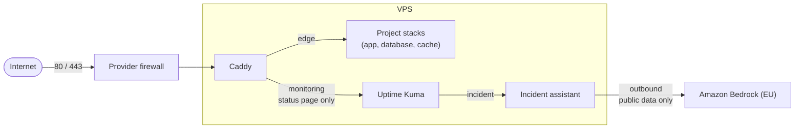

# V-Server Setup and Hardening

How the production VPS (Hostinger KVM, Ubuntu LTS, Frankfurt) was set up, hardened and is operated. Every step names the decision behind it and how to verify it.

## Table of Contents

- [Task](#task)
- [Problem](#problem)
- [Approach](#approach)
  - [1. SSH keys and access](#1-ssh-keys-and-access)
  - [2. SSH hardening](#2-ssh-hardening)
  - [3. Firewall](#3-firewall)
  - [4. Automatic security updates](#4-automatic-security-updates)
  - [5. System basics](#5-system-basics)
  - [6. Docker from the official repository](#6-docker-from-the-official-repository)
  - [7. Deploy user](#7-deploy-user)
  - [8. Edge proxy and network separation](#8-edge-proxy-and-network-separation)
  - [9. Delivery](#9-delivery)
  - [10. Monitoring](#10-monitoring)
  - [11. Backup and restore](#11-backup-and-restore)
- [Solution](#solution)
- [Evidence](#evidence)
- [Related repositories](#related-repositories)
- [License](#license)

Placeholders: `<admin-user>` is the personal sudo account, `<deploy-user>` the account CI uses, `<host>` the server.

---

## Task

One server hosts several containerised projects behind a single reverse proxy with TLS, plus uptime monitoring with a public status page and an incident assistant that drafts its analysis with an LLM on Amazon Bedrock (EU). One person runs it. The setup has to be safe on the public internet, reproducible from this document and changeable without locking the admin out.

## Problem

- **Internet-facing host:** a public server is scanned within minutes. Password logins, open ports and unpatched packages are found and tried.
- **Single admin:** there is no second person to notice a mistake or to recover access. A broken SSH config can mean a locked-out server.
- **Docker bypasses `ufw`:** a container port published with `ports:` is opened through Docker's own firewall rules, past `ufw`. A host firewall alone does not protect it.
- **Secrets:** CI needs a way onto the server, and the stacks need credentials. Neither may end up in Git or give more access than needed.
- **Updates:** a one-time upgrade only protects until the next published vulnerability.
- **Data loss:** a bad deploy, a deleted volume or a full disk can destroy the database. A backup that was never restored is not a backup.
- **Change without lockout:** every change to SSH, firewall or the stacks needs a way back.

## Approach

Steps 1 to 6 apply to any new Ubuntu VPS. Steps 7 to 11 describe how the projects run on it. Server commands run as `<admin-user>` unless stated otherwise.

### 1. SSH keys and access

**What:** bring the system up to date, create a personal sudo account and log in with an SSH key only.

**Why:** a key cannot be guessed like a password, and a named account instead of `root` leaves a trace of who did what. ed25519 keys are short and strong.

**Commands:**

```bash
# server, first login with the provider's initial access
sudo apt update && sudo apt full-upgrade
sudo adduser <admin-user>
sudo usermod -aG sudo <admin-user>
```

```bash
# local machine
ssh-keygen -t ed25519
ssh-copy-id -i ~/.ssh/id_ed25519.pub <admin-user>@<host>
```

**Verify:**

```bash
apt list --upgradable                          # nothing listed
ssh -i ~/.ssh/id_ed25519 <admin-user>@<host>    # login without a password prompt
```

### 2. SSH hardening

**What:** turn off password, keyboard-interactive and root logins in a drop-in file, test in a second session before closing the first, keep a rollback ready.

**Why:** sshd reads the drop-ins in `/etc/ssh/sshd_config.d/` before the main file and keeps the **first** value it finds, so the cloud image's `50-cloud-init.conf` (`PasswordAuthentication yes`) silently won over the edit in `sshd_config` here and the first test still showed a password prompt. `00-hardening.conf` is read first and wins; `50-cloud-init.conf` is corrected as well, and cloud-init is told not to turn password login back on.

**Commands:**

```bash
sudo tee /etc/ssh/sshd_config.d/00-hardening.conf <<'EOF'
PasswordAuthentication no
KbdInteractiveAuthentication no
PermitRootLogin no
PubkeyAuthentication yes
X11Forwarding no
EOF
sudo sed -i 's/^PasswordAuthentication yes/PasswordAuthentication no/' /etc/ssh/sshd_config.d/50-cloud-init.conf
echo 'ssh_pwauth: false' | sudo tee /etc/cloud/cloud.cfg.d/99-disable-pwauth.cfg
sudo sshd -t && sudo systemctl restart ssh
```

Keep this session open. Open a second terminal and log in again. Only close the first session once the second login works.

Rollback, in the session that is still open (undoes all three changes):

```bash
sudo rm /etc/ssh/sshd_config.d/00-hardening.conf /etc/cloud/cloud.cfg.d/99-disable-pwauth.cfg
sudo sed -i 's/^PasswordAuthentication no/PasswordAuthentication yes/' /etc/ssh/sshd_config.d/50-cloud-init.conf
sudo sshd -t && sudo systemctl restart ssh
```

**Verify:**

```bash
# server: the effective configuration, not the file
sudo sshd -T | grep -Ei 'passwordauth|kbdinteractive|permitroot|pubkeyauth'
# passwordauthentication no, kbdinteractiveauthentication no, permitrootlogin no, pubkeyauthentication yes
```

```bash
# local machine
ssh -o PubkeyAuthentication=no -o PreferredAuthentications=password <admin-user>@<host>   # Permission denied (publickey)
ssh root@<host>                                                                          # Permission denied (publickey)
```

### 3. Firewall

**What:** a firewall at the provider, in front of the server, allows only 22 (SSH), 80 and 443 (HTTP and HTTPS).

**Why:** Docker publishes container ports past `ufw` (see [Problem](#problem)). A provider firewall filters before traffic reaches the host, so a published port that slipped through stays closed from outside. As a second layer, only the reverse proxy publishes ports at all (step 8).

**Commands:** the rules are set in the provider's dashboard, not on the server.

**Verify:**

```powershell
# local machine (Windows): a port outside 22/80/443 must not answer
Test-NetConnection <host> -Port <other-port>   # TcpTestSucceeded : False
```

```bash
# server: what listens, and where
sudo ss -tlnp
```

Everything except SSH, 80 and 443 has to be bound to loopback (`127.0.0.1`) or stay inside Docker networks. Repeat this check after every new stack.

### 4. Automatic security updates

**What:** `unattended-upgrades` installs security updates every day.

**Why:** known holes in OpenSSH, OpenSSL or the kernel are often exploited within days of being published. Automatic updates close them without anyone logging in. The trade-off: they do not reboot by default, and kernel updates need a reboot. Reboots are done by hand when `/var/run/reboot-required` exists; every long-running container uses `restart: unless-stopped` and comes back on its own, which was checked after a real reboot.

**Commands:**

```bash
sudo apt install unattended-upgrades
sudo dpkg-reconfigure --priority=low unattended-upgrades
```

**Verify:**

```bash
systemctl status unattended-upgrades --no-pager      # active
systemctl list-timers apt-daily-upgrade.timer --no-pager   # next run listed
cat /etc/apt/apt.conf.d/20auto-upgrades              # both values "1"
sudo unattended-upgrade --dry-run --debug            # dry run without installing
ls /var/run/reboot-required 2>/dev/null              # exists only when a reboot is due
```

The log is in `/var/log/unattended-upgrades/`.

### 5. System basics

**What:** time in UTC and synchronised, a swap file used only under memory pressure, a weekly Docker cleanup that never touches volumes.

**Why:** a correct clock in UTC keeps TLS, token lifetimes and log order right without daylight-saving jumps, and swap with `vm.swappiness=10` is a safety net against the OOM killer during peaks (video encoding), not a replacement for memory limits per container. Old image versions pile up after every deploy, so a systemd timer (journal, catch-up after downtime) removes them weekly, but never volumes, which hold databases and media.

**Commands:**

```bash
# time
timedatectl                                   # time zone UTC stays

# swap (ext4; on btrfs swap files need a different procedure)
findmnt -no FSTYPE /
sudo fallocate -l 4G /swapfile
sudo chmod 600 /swapfile                      # root only: memory pages, secrets included, can land in swap
sudo mkswap /swapfile
sudo swapon /swapfile
echo '/swapfile none swap sw 0 0' | sudo tee -a /etc/fstab
sudo systemctl daemon-reload
echo 'vm.swappiness=10' | sudo tee /etc/sysctl.d/99-swap.conf
sudo sysctl -p /etc/sysctl.d/99-swap.conf
```

```bash
# weekly Docker cleanup, never volumes
sudo tee /etc/systemd/system/docker-prune.service <<'EOF'
[Unit]
Description=Remove unused Docker images and build cache older than 7 days (never volumes)
Requires=docker.service
After=docker.service

[Service]
Type=oneshot
ExecStart=/usr/bin/docker image prune --all --force --filter "until=168h"
ExecStart=/usr/bin/docker builder prune --force --filter "until=168h"
EOF

sudo tee /etc/systemd/system/docker-prune.timer <<'EOF'
[Unit]
Description=Weekly Docker cleanup

[Timer]
# weekly, in UTC
OnCalendar=<weekday> <time> UTC
Persistent=true
RandomizedDelaySec=15m

[Install]
WantedBy=timers.target
EOF

sudo systemd-analyze verify /etc/systemd/system/docker-prune.service /etc/systemd/system/docker-prune.timer
sudo systemctl daemon-reload
sudo systemctl enable --now docker-prune.timer
```

**Verify:**

```bash
timedatectl                              # System clock synchronized: yes, NTP service: active, Time zone: Etc/UTC
swapon --show && ls -l /swapfile         # 4G swap file, -rw------- root root
sudo findmnt --verify                    # 0 parse errors, 0 errors
cat /proc/sys/vm/swappiness              # 10
systemctl list-timers docker-prune.timer --no-pager      # next run listed
sudo systemctl start docker-prune.service
systemctl status docker-prune.service --no-pager         # both ExecStart: status=0/SUCCESS
```

Never put `docker system prune --volumes` into an automatic job: it deletes unused volumes, possibly the database of a stack that is stopped for a moment.

### 6. Docker from the official repository

**What:** Docker Engine and the Compose plugin from Docker's apt repository, following the [Docker install guide](https://docs.docker.com/engine/install/ubuntu/), with the signing key checked and bound to that repository only, and hardened daemon defaults.

**Why:** the official repository is a traceable source for a current engine, unlike piping `get.docker.com` into a root shell, and its key is trusted only after the fingerprint matches Docker's release key, bound by `Signed-By` to this repository only (the old `apt-key` trusted it for every source). The admin account stays out of the group `docker`, because that group is effectively root (`docker run -v /:/host ...`) and would skip the sudo password; the admin uses `sudo docker`.

**Commands:**

```bash
# key
sudo apt update
sudo apt install -y ca-certificates curl
sudo install -m 0755 -d /etc/apt/keyrings
sudo curl -fsSL https://download.docker.com/linux/ubuntu/gpg -o /etc/apt/keyrings/docker.asc
sudo chmod a+r /etc/apt/keyrings/docker.asc
gpg --show-keys /etc/apt/keyrings/docker.asc   # verify the fingerprint before trusting the repository
# 9DC8 5822 9FC7 DD38 854A  E2D8 8D81 803C 0EBF CD88
# uid  Docker Release (CE deb) <docker@docker.com>
# stop if it differs

# repository, key bound to it
sudo tee /etc/apt/sources.list.d/docker.sources <<EOF
Types: deb
URIs: https://download.docker.com/linux/ubuntu
Suites: $(. /etc/os-release && echo "${UBUNTU_CODENAME:-$VERSION_CODENAME}")
Components: stable
Architectures: $(dpkg --print-architecture)
Signed-By: /etc/apt/keyrings/docker.asc
EOF
sudo apt update
sudo apt install -y docker-ce docker-ce-cli containerd.io docker-buildx-plugin docker-compose-plugin
```

```bash
# daemon defaults: log rotation, containers survive a daemon restart, no privilege escalation
sudo tee /etc/docker/daemon.json <<'EOF'
{
  "log-driver": "json-file",
  "log-opts": { "max-size": "10m", "max-file": "3" },
  "live-restore": true,
  "no-new-privileges": true
}
EOF
sudo dockerd --validate --config-file /etc/docker/daemon.json
sudo systemctl restart docker
```

- **Log rotation:** without it container logs grow until the disk is full. The stacks themselves log to journald, because `json-file` can only rotate by size and the privacy policy promises 14 days; the time limit is a journald setting from [vps-edge](https://github.com/PhilippKlinger/vps-edge#log-retention).
- **`live-restore`:** containers keep running when the Docker service restarts, for example after an update.
- **`no-new-privileges`:** processes in a container cannot gain rights through setuid binaries.
- **`--validate` first:** a broken `daemon.json` would stop the service from starting.

**Verify:**

```bash
apt-cache policy docker-ce | head -5           # Candidate from download.docker.com
docker compose version                         # Compose v2 plugin, not docker-compose v1
sudo systemctl is-active docker containerd     # active, active
sudo docker info --format 'Logging: {{.LoggingDriver}} | LiveRestore: {{.LiveRestoreEnabled}} | Security: {{.SecurityOptions}}'
# Logging: json-file | LiveRestore: true | Security: [... no-new-privileges]
sudo docker run --rm alpine grep NoNewPrivs /proc/self/status   # NoNewPrivs: 1

# log rotation on a real container, not only in the daemon config
sudo docker run --name hw hello-world                            # "Hello from Docker!"
sudo docker inspect hw --format '{{.HostConfig.LogConfig.Type}} {{.HostConfig.LogConfig.Config}}'
# json-file map[max-file:3 max-size:10m]
sudo docker rm hw && sudo docker image rm hello-world alpine     # clean up the test
```

### 7. Deploy user

**What:** a separate account for CI with Docker access but no sudo, a locked password, one SSH key per repository and an SSH session that can only run commands.

**Why:** CI logs in from GitHub Actions and starts the stacks with `docker compose`, so its private key lives outside the server. Docker access cannot be taken away without breaking the deploy, and it is effectively root. The strategy is therefore to separate and remove everything else: no interactive shell, no tunnels into the internal Docker networks, no forwarding. One key per repository means a leaked key can be revoked without touching the other projects.

**Commands:**

```bash
sudo useradd --create-home --shell /bin/bash --groups docker <deploy-user>
sudo install -d -m 700 -o <deploy-user> -g <deploy-user> /home/<deploy-user>/.ssh
sudo install -m 600 -o <deploy-user> -g <deploy-user> /dev/null /home/<deploy-user>/.ssh/authorized_keys
# one directory per stack, mode 750, owned by <deploy-user>: the .env with secrets lives there

sudo tee /etc/ssh/sshd_config.d/99-deploy-user.conf <<'EOF'
Match User <deploy-user>
    PermitTTY no
    AllowTcpForwarding no
    AllowAgentForwarding no
    AllowStreamLocalForwarding no
    X11Forwarding no
    PermitTunnel no
    GatewayPorts no
    PermitUserRC no
EOF
sudo sshd -t && sudo systemctl restart ssh    # keep the current session open, test a new login
```

The `Match` block sits in a file read last (`99-`), because a `Match` block applies until the next `Match` or the end of input and would otherwise capture global settings read after it. Rollback: delete `99-deploy-user.conf` and restart ssh.

Per repository, on the local machine, never on the server:

```bash
ssh-keygen -t ed25519 -N "" -C "gha-deploy-<repo>" -f gha-deploy-<repo>
# private key -> GitHub secret of the environment "production", then delete the local file
# public key  -> one line in authorized_keys of <deploy-user>
```

The server's host key fingerprint (`ssh-keygen -lf /etc/ssh/ssh_host_ed25519_key.pub`) is compared with the result of `ssh-keyscan` before it goes into the `SSH_KNOWN_HOSTS` secret, so CI cannot be redirected to another host.

**Verify:**

```bash
sudo -l -U <deploy-user>          # not allowed to run sudo
sudo passwd -S <deploy-user>      # L (password locked)
# effective config per user, compared side by side
F='^(permittty|allowtcpforwarding|allowagentforwarding|allowstreamlocalforwarding|x11forwarding|permittunnel|passwordauthentication|permitrootlogin)'
sudo sshd -T -C user=<deploy-user>,host=test,addr=127.0.0.1 | grep -Ei "$F"   # all "no"
sudo sshd -T -C user=<admin-user>,host=test,addr=127.0.0.1  | grep -Ei "$F"
# admin: permittty, allowtcpforwarding, allowagentforwarding, allowstreamlocalforwarding yes;
#        x11forwarding, permittunnel, passwordauthentication, permitrootlogin no
```

```bash
# local machine
ssh -i gha-deploy-<repo> <deploy-user>@<host> 'docker compose version'   # works
ssh -i gha-deploy-<repo> <deploy-user>@<host>                            # PTY allocation request failed
```

Not done on purpose: rootless Docker (the proxy could not bind 80/443 without extra work), a forced `command=` per key (the deploy sends several commands; a candidate for later) and `from=` IP restrictions (GitHub runners change their addresses).

### 8. Edge proxy and network separation

**What:** [Caddy](https://caddyserver.com/) in its own stack ([vps-edge](https://github.com/PhilippKlinger/vps-edge)) is the only container that publishes ports to the outside (80, 443, 443/udp). Every other stack publishes nothing and gets its own Docker networks.

**Why:** Caddy gets TLS certificates on its own and works from a static `Caddyfile`, without access to the Docker socket. Traefik would need the socket for its automatic routing, and access to the socket is root on the host. Separate networks keep a compromised container from reaching databases or other projects.

| Network | Members | Route to the internet |
|---|---|---|
| `edge` | Caddy and the project services it serves | yes |
| internal network per project stack | app, database, cache | no |
| `outbound` per stack | only services that must call out (mail, monitoring checks, GitHub, Telegram and Amazon Bedrock for the assistant) | yes |
| `monitoring` | Caddy and Uptime Kuma, status page only | no |
| `incident` | Uptime Kuma and the incident assistant, alert webhook only | no |

The incident assistant ([vps-incident-assistant](https://github.com/PhilippKlinger/vps-incident-assistant)) reaches Amazon Bedrock only through its `outbound` network. Only public data goes there: the rule result, monitoring facts, changes from public repositories and runbook excerpts, processed in the EU; no personal data. Caddy, Uptime Kuma, the incident assistant and the Videoflix application containers drop all capabilities and set `no-new-privileges` (Caddy keeps only the one to bind 80/443). The Videoflix database and cache keep Docker's default capabilities and get `no-new-privileges` from the daemon default (step 6). Every image is pinned by digest. Caddy has its admin API off, sets security headers (HSTS, `nosniff`, referrer policy), removes the `Server` header and writes no access log, because activation and reset tokens are part of request paths.

**Commands:** the stack is started from the repository, see [vps-edge](https://github.com/PhilippKlinger/vps-edge#usage-on-the-server). A new project gets one file in `sites/` and joins `edge` as an external network.

**Verify:**

```bash
# only Caddy publishes on all interfaces
sudo docker ps --format '{{.Names}}\t{{.Ports}}'
# which networks are internal (no route outside)
for n in $(sudo docker network ls -q); do sudo docker network inspect "$n" --format '{{.Name}} internal={{.Internal}}'; done
```

```bash
# local machine: HTTP redirects to HTTPS, headers are set
curl -sI http://videoflix.philipp-klinger.com | head -1                           # 308 Permanent Redirect
curl -sI https://videoflix.philipp-klinger.com | grep -iE 'strict-transport|nosniff|referrer'
```

The CI of vps-edge starts the real proxy configuration on every pull request and checks routing, redirects, headers and that `monitoring` is internal.

### 9. Delivery

**What:** application repositories build images in CI and push them to GHCR. A separate deploy repository ([videoflix-deploy](https://github.com/PhilippKlinger/videoflix-deploy)) pins every image by digest and is the only place with SSH access to the server.

**Why:** the server never builds; it only pulls images that CI built and scanned. A digest cannot be moved like a tag, so one commit in the deploy repository equals one running combination. Build and deploy are separated: the application repositories have no access to the server. The SSH secrets live only in the GitHub environment; application secrets stay in a `.env` on the server (mode `600`, gitignored) and are never copied by CI.

**Commands:** a deploy runs only through the workflow in the GitHub environment `production`:

1. The backend or frontend CI publishes an image and triggers the deploy with its digest.
2. On the server, as `<deploy-user>` over SSH: pull the deploy repository, write the digest, start with `docker compose up -d --no-build --wait`.
3. A smoke test from the runner checks the site the way a visitor does: health endpoint, app shell, certificate valid for at least 7 more days.
4. On failure the previous images and commit are restored and checked again; the run stays red.
5. On success a pull request pins the new digest in `compose.yaml`.

Rollback by hand: start the deploy workflow with an earlier digest; the history of `compose.yaml` lists them. Migrations are not reverted, so an older backend must still work with the newer schema.

**Verify:**

```bash
curl -s https://videoflix.philipp-klinger.com/api/health/      # {"status":"ok","database":"ok","cache":"ok"}
```

```bash
# server: the image reference each service was started with
sudo -u <deploy-user> sh -c 'cd <stack-dir> && docker compose ps --format "{{.Service}} {{.Image}}"'
# web ghcr.io/...@sha256:<digest>   same digest as in the last deploy summary in GitHub Actions
```

### 10. Monitoring

**What:** [Uptime Kuma](https://github.com/louislam/uptime-kuma) in its own stack ([vps-monitoring](https://github.com/PhilippKlinger/vps-monitoring)) checks every public URL, alerts by Telegram and serves the public status page. Alerts also go to the incident assistant, which opens a GitHub issue per incident.

**Why:** Kuma checks from the outside (DNS, certificate, proxy, app) instead of looking into containers, so it needs no Docker socket and is not part of `edge`. Caddy lets only the status page, its read-only API, badges and static files through; the dashboard and login are never public and are reached only through an SSH tunnel. The tunnel works for `<admin-user>` only, since `<deploy-user>` has forwarding turned off.

**Commands:**

```bash
# local machine: open the dashboard through a tunnel to the loopback-bound port
ssh -L <dashboard-port>:127.0.0.1:<dashboard-port> <admin-user>@<host>
# then browse http://localhost:<dashboard-port>
```

Monitors: interval 60 s, 3 retries, certificate expiry warning 14 days ahead.

**Verify:**

```bash
curl -sI https://status.philipp-klinger.com/status/videoflix | head -1    # 200
curl -sI https://status.philipp-klinger.com/dashboard | head -1           # 404
```

Limit: Kuma runs on the server it watches. If the whole server is down, no alert goes out; an external check is planned.

### 11. Backup and restore

**What:** a systemd timer writes a Postgres dump every night and a media archive once a week. A restore test restores the newest backup into a separate throwaway database and checks it against the live data. The result is recorded in `restore-test.json` in [videoflix-deploy](https://github.com/PhilippKlinger/videoflix-deploy).

**Why:** a backup counts only once a restore has worked. The restore test runs without touching live data or taking the site down, so it can be repeated at any time. The timer runs as `<deploy-user>`, catches up after downtime (`Persistent=true`) and keeps dumps for 14 days.

**Commands:** scripts and units are in [videoflix-deploy](https://github.com/PhilippKlinger/videoflix-deploy#backup-and-restore).

- `backup.sh` writes each backup to a temporary file and renames it only after a check, so a failed run leaves nothing that looks like a backup.
- `restore-test.sh` drops the throwaway database on exit, also on failure, because it contains personal data.

```bash
# backup directory: owned by <deploy-user>, group-readable for <admin-user> to copy dumps off the server
sudo install -d -m 2750 -o <deploy-user> -g <admin-user> <backup-dir>
sudo cp <stack-dir>/backup/videoflix-backup.service <stack-dir>/backup/videoflix-backup.timer /etc/systemd/system/
sudo systemctl daemon-reload
sudo systemctl enable --now videoflix-backup.timer
# first backup by hand, including the media archive
sudo -u <deploy-user> <stack-dir>/backup/backup.sh --with-media
```

**Verify:**

```bash
systemctl list-timers videoflix-backup.timer --no-pager    # next run listed
systemctl status videoflix-backup.service --no-pager       # status=0/SUCCESS after a run
sudo -u <deploy-user> <stack-dir>/backup/restore-test.sh   # ends with "Restore test passed."
```

Limits: the backups stay on the VPS. They protect against bad deploys and deleted data, not against losing the server; a dump is copied off the server by hand and stored encrypted. The `.env` files are not part of the backup; their values are kept in a password manager.

---

## Solution

- SSH with keys only, no root, no passwords; the effective sshd config is checked with `sshd -T`, every change is tested in a second session.
- A provider firewall allows 22, 80 and 443; only the reverse proxy publishes ports.
- Security updates install themselves; time, swap and disk space are taken care of.
- Docker from a verified source with log rotation, `live-restore` and `no-new-privileges`.
- CI deploys with its own restricted account, one key per repository, images pinned by digest, a smoke test and automatic rollback.
- Each stack has its own networks; databases have no route to the internet.
- Monitoring from the outside with a public status page, and a nightly backup with a restore test.



## Evidence

| Link | What it shows |
|---|---|
| [status.philipp-klinger.com](https://status.philipp-klinger.com) | Public status page |
| [videoflix.philipp-klinger.com](https://videoflix.philipp-klinger.com) | The application running on this server |

The configuration and CI behind each step live in the repositories below.

## Related repositories

| Repository | Role |
|---|---|
| [vps-edge](https://github.com/PhilippKlinger/vps-edge) | Caddy configuration, networks `edge` and `monitoring`, log retention, CI that tests the proxy |
| [vps-monitoring](https://github.com/PhilippKlinger/vps-monitoring) | Uptime Kuma stack, status page allowlist, dashboard only through a tunnel |
| [videoflix-deploy](https://github.com/PhilippKlinger/videoflix-deploy) | Images pinned by digest, deploy workflow with smoke test and rollback, backup and restore test |
| [vps-incident-assistant](https://github.com/PhilippKlinger/vps-incident-assistant) | Alert to GitHub issue, analysis drafted with an LLM on Amazon Bedrock (EU), public data only |

## License

[MIT](LICENSE)
